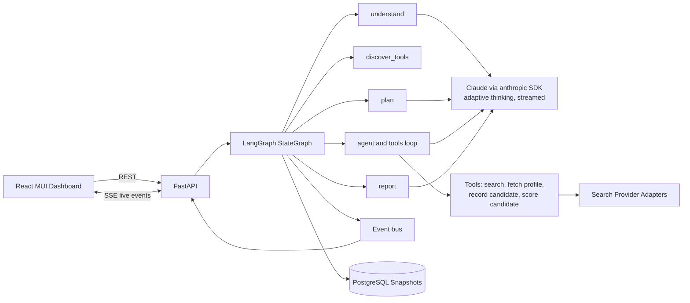

# Architecture

- `POST /api/campaigns/{id}/start` launches the graph as a background task and returns at once.
- Every LLM call publishes reasoning, text and tool activity to an in-process event bus
  (`backend/app/services/events.py`); `GET /api/campaigns/{id}/events` replays the history and then
  streams live events as Server-Sent Events.
- Campaigns are held in memory (`CampaignStore`) with best-effort JSON snapshots in PostgreSQL.
