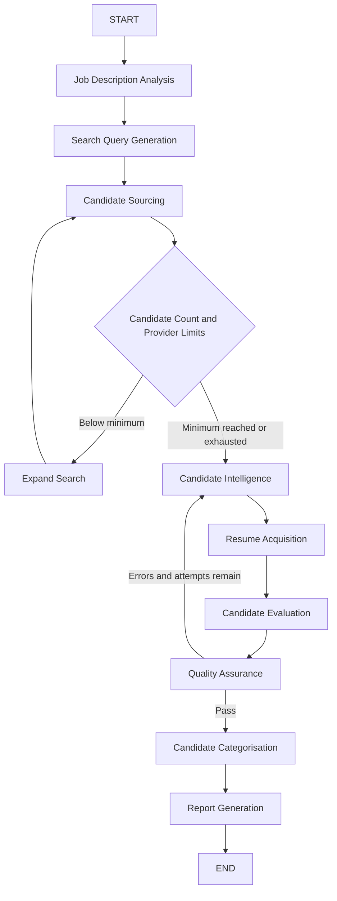

# LangGraph Workflow

The implementation is a real LangGraph StateGraph with typed state, conditional retry routing,
bounded search attempts, checkpoint-ready state, and actual provider calls. Search-provider
credentials are required for live results. No candidate is fabricated when no provider is configured
or when source coverage is exhausted.
