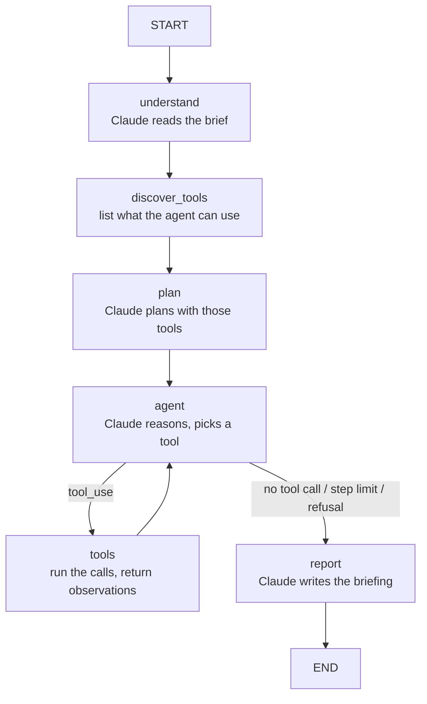

# LangGraph Workflow

Every stage is a real LangGraph node, and the loop `agent ⇄ tools` is the graph itself
(`backend/app/graph/workflow.py`). Claude decides which tool to call and when to stop;
`route_after_agent` only enforces the step limit (`MAX_AGENT_ITERATIONS`).

## What the audience sees

Each LLM call streams to the browser over SSE (`GET /api/campaigns/{id}/events`):

| Event | Meaning |
|---|---|
| `node_start` / `node_end` | A graph node began or finished |
| `block_start`, `thinking_delta`, `text_delta`, `block_end` | Claude's summarized reasoning and text, token by token |
| `tools_available` | The tool catalog shown in the "Discover tools" step |
| `plan` | The structured plan from the planning node |
| `tool_call` / `tool_result` | The agent's action and the observation it got back |
| `error` / `done` | Failure details / end of run |

Reasoning comes from Claude's adaptive thinking with `display: "summarized"`.

## Agent tools (`backend/app/graph/tools.py`)

`search_professional_profiles`, `fetch_public_profile`, `record_candidate`, `score_candidate`.
Claude judges each criterion 0-100 from evidence; the server applies the campaign weights
and computes the total and HIGH/MEDIUM/LOW band. No candidate is fabricated: the agent can
only record profiles it saw in tool results, and `ANTHROPIC_API_KEY` is required.
